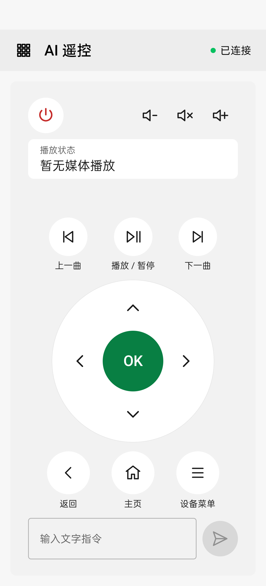

# AI 遥控 · AIRC

Kotlin Multiplatform 遥控器，当前实现 Android 手机端（`ernest.airc`）、Compose JVM 桌面测试工具与目标 Android 设备上的原生 `airc-runtime`。通过 ADB 安装设备端程序，随后使用局域网 WebSocket 遥控，支持独立 mDNS 发现、设备历史、文字指令。

- 方向、确认、音量及应用管理直接调用工具，无需配置模型；[应用详情](docs/guide/apps.md)支持权限、运行状态、缓存、数据与卸载管理。
- 自然语言文字交给兼容的模型服务，经过工具调用执行任务。
- 支持目标 TCP ADB、无线配对码和二维码，不提供 USB 或控制手机本机配对。
- 管理设备端版本、状态、更新、重启与停止。
- 功能 → 设置提供跟随系统、亮色和暗色外观，选择即时生效并保存在当前控制端。



## 快速开始

维护者公开的生产签名 APK 见 [GitHub Releases](https://github.com/Ernest-su/ai-remote-controller/releases)；若没有公开版本，可从源码构建。需要 JDK 17、Android SDK 36、NDK、Rust 和 Python 3.11+：

```sh
export ANDROID_HOME=/path/to/android-sdk
export ANDROID_NDK_HOME="$ANDROID_HOME/ndk/28.2.13676358"
./gradlew :androidApp:assembleDebug --no-daemon
```

APK 输出：`androidApp/build/outputs/apk/debug/androidApp-debug.apk`。安装到控制手机，在目标设备启用 ADB，点击右上角连接状态，进入“设备”页连接并部署。详细前提和步骤见[快速开始](docs/getting-started.md)。

单独调试设备端：执行 `./android-build-run.sh` 自动构建目标 ABI、ADB 推送并后台启动 runtime，参数见[构建文档](docs/development/build.md)。

## 桌面测试工具

```sh
./gradlew --no-daemon :desktopApp:run
```

默认 390×844dp 的 Compose 窗口，复用模型配置、应用列表、触控板与数字键盘组件，可使用宿主机 adb 连接和部署。后续业务/UI 联调优先运行 JVM 测试，详见[桌面指南](docs/guide/desktop.md)。

## 文档

文档以 Markdown 与源码共同维护，使用 MkDocs Material 构建。

| 读者 | 入口 |
| --- | --- |
| 使用者 | [文档首页](docs/index.md)、[连接设备](docs/guide/connections.md)、[遥控与文字](docs/guide/remote.md) |
| 接口集成者 | [协议](docs/protocol.md)、[工具参考](docs/reference/tools.md) |
| 开发者 | [架构](docs/development/architecture.md)、[构建](docs/development/build.md)、[测试](docs/development/testing.md) |
| 贡献者 | [贡献指南](CONTRIBUTING.md)、[文档维护](docs/development/documentation.md) |
| 维护者 | [发布](docs/development/releasing.md) |

推送 main 会自动构建 debug APK 与三 ABI runtime，并将文档站点发布到独立 `gh-pages` 分支；Actions artifacts 可用于开发测试。首次 Pages 配置见[文档维护](docs/development/documentation.md)。

本地预览：

```sh
python3 -m venv .venv-docs
.venv-docs/bin/python -m pip install -r requirements-docs.txt
.venv-docs/bin/python -m mkdocs serve
```

## 当前范围

Android 控制端与 JVM 桌面测试工具，共享协议与设备记录位于 `shared/commonMain`。iOS、鸿蒙适配尚未实现。实际摄像头配对、厂商输入行为、网络条件和模型提供商兼容性需按使用环境分别验证。设备端默认以 ADB shell 身份运行，可在功能网格的“运行权限”开启优先 root 并自动检测，协议不提供登录鉴权；高影响管理动作按各自流程确认，使用环境应为可信局域网。功能与使用限制见对应使用指南。

视觉规范参考[微信官方 WeUI](https://github.com/Tencent/weui)，项目约束见[视觉与交互规范](docs/development/visual-guidelines.md)；ADB 依赖 [ernest-su/adb](https://github.com/ernest-su/adb)。

设备预览支持手动捕获、预览、保存 PNG，手机可系统分享；参见[截图指南](docs/guide/screenshots.md)。

## 许可证与正式发布

项目原创代码采用 [MIT License](LICENSE)，第三方代码保留原许可证，见[第三方声明](THIRD_PARTY_NOTICES.md)。

签名与 GitHub Actions 配置见[发布指南](docs/development/releasing.md)。`v*` 标签触发检查、生产签名 APK 与三 ABI runtime 清单签名，产物上传到草稿 Release；维护者核对后公开。公钥和 APK 证书指纹随源码提供，私钥仅存于仓库外及 GitHub Actions Secrets。

应用管理在被控端缓存名称、信息和图标，刷新时按实际安装版本与资源配置校验，保留未变化的图标；权限与运行状态仍实时读取。详见[应用管理](docs/guide/apps.md)。

文件管理的底部图标栏支持更多菜单，操作弹窗只显示当前任务。粘贴网址后自动识别文件名与大小，可选择保存目录、修改名称并查看下载进度，默认保存到被控设备存储卡 Download。文件管理支持图片、音视频、文本缩略图与预览，明确区分主控设备播放和被控设备播放；APK 可显示包内图标、预览信息并经确认在被控设备安装。使用方法与平台差异见[文件管理](docs/guide/files.md#file-preview)。

手机日常操作还支持：

- [播放控制](docs/guide/media.md)：拖动进度、前后 10/30 秒、按分:秒跳转。
- [常用应用](docs/guide/apps.md)：搜索和筛选系统/用户应用，星标收藏并优先展示，按电视保存顺序和最近启动记录。
- [电视输入与快捷操作](docs/guide/remote.md)：无需模型的中文输入，支持剪贴板粘贴与配套电视输入法提交，可选应用、选按键、按秒设置等待，编辑步骤顺序、直接执行及暂停，并查看最后一次执行详情；手机音量键与保持亮屏可在设置中开启。
- [系统分享](docs/guide/files.md)：从浏览器、相册或文件管理器分享网址、文字和单个文件，核对电视后再提交。
- [连接状态](docs/guide/connections.md)：遥控服务、ADB 和动态预览分别展示并提供恢复入口。
- [动态预览](docs/guide/screenshots.md)：流畅、均衡、清晰三档，默认使用便于点按的紧凑悬浮遥控。
