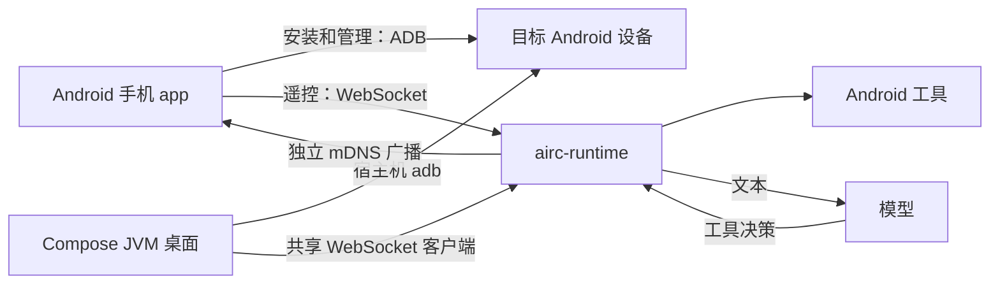

# 架构与项目边界

| 目录 | 职责 |
| --- | --- |
| `shared/` | KMP commonMain 的协议、设备历史、发布清单与验证；Android/JVM 目标 |
| `sharedUi/` | Android/JVM 共用主题、模型编辑、应用列表、触控板、数字键盘与导航枚举 |
| `client/` | Android/JVM 共用的连接、模型配置与业务控制器 |
| `androidApp/` | Android Activity、ADB 库、NSD、Keystore、设备页与安装器 |
| `desktopApp/` | KMP JVM Compose 窗口、宿主机 adb、桌面私有存储与 JVM UI/真实目标联调 |
| `runtime/` | Rust HTTP/WS、mDNS、工具、LLM 与后台生命周期 |
| `scripts/` | ABI 构建、签名发布准备、本地验收 |
| `docs/` | 面向使用者、集成者与贡献者的文档源码 |

手机首先以 `ernest-su/adb` 推送与管理二进制，日常操作通过 runtime WebSocket。ADB mDNS 与 `_airc._tcp.` 独立；服务 UUID 在更新/重启后保持稳定。

普通遥控按键、其他直接工具与文字/配置使用独立队列；每条队列保持内部 FIFO，会话内的模型对话历史受互斥保护。模型与手动普通按键共用有界的输入执行器，模型无需额外的命令执行通道。

设备端进程脱离 ADB 标准输入/输出，通过文件锁、PID、启动时间和可执行路径管理生命周期。当前不含 TUI、Web UI、登录或安全确认。

## 后续平台

iOS/鸿蒙目前没有实现。共享模型不依赖 Android UI；新增平台需要实现网络、发现与持久化适配，并明确对应平台能否提供 ADB 安装通道。不能把 KMP 共享协议视为所有平台能力已经可用。

## 设计参考

视觉与导航遵守[微信 WeUI 参考下的项目约束](visual-guidelines.md)，Compose 主题与组件集中管理。早期遥控器布局参考 [AIVoice hos](https://gitee.com/ernestX/aivoice/tree/hos/AIVoiceClient/phoneRemoteApp)，底层使用 [ernest-su/adb](https://github.com/ernest-su/adb)。后台、工具与版本管理参考 [nl2sh](https://github.com/nl2sh/nl2sh) 与 [nl2sh-helper](https://github.com/nl2sh/nl2sh-helper)。AIRC 是独立实现，不声明具备这些项目的全部功能。

截图命令位于 `runtime/src/tools/screenshot.rs`，内存资源及 HTTP 下载在 `runtime/src/artifacts.rs`；共享描述在 `shared/tools/BinaryArtifact.kt`，控制端下载位于 `client/transfer/RuntimeArtifactClient.kt`。工具 JSON 与二进制响应分开，模型和直接请求共用捕获工具。

连接诊断数据类在 `shared/tools/NetworkDiagnostics.kt`，探测与取消状态由 `client/diagnostics/NetworkDiagnostics.kt` 管理，采用独立 RuntimeConnection，平台只提供已授权 ADB 与发现观察适配；共享 Compose 卡片不包含平台网络调用。

桌面发现适配在 `desktopApp/platform/DesktopDiscovery.kt`，依赖固定版本 JmDNS 3.6.3，绑定通往目标的 IPv4 接口；每次探测拥有独立实例，结束或取消后关闭，不影响其他发现服务。参考 [JmDNS 官方 API](https://github.com/jmdns/jmdns/blob/main/src/main/java/javax/jmdns/JmDNS.java)。

文件路径、列表和属性在 `runtime/src/tools/files.rs`，通过目录描述符逐层打开 Downloads、服务收件箱或明确选择的全盘相对路径。`runtime/src/transfers/` 分离任务创建、状态、HTTP 流与测试；`file_actions.rs` 管理覆盖/删除提案与确认。shared 的 `tools/TargetFiles.kt` 定义协议模型，client 的 FileBrowserController/FileTransferController 和 RuntimeTransferClient 管理缓存、取消、流式读写与摘要，共享 Compose 组件负责呈现，平台仅适配文件选择器与保存。服务端继续运行于 shell/root 二进制进程，不新增目标 APK。

媒体打开和处理器查询在 `runtime/src/tools/media_open.rs`，私有文件 HTTP 资源在 `runtime/src/media_resources/`，按注册、Range 流和测试拆分。client 的 FileMediaController 管理查询、选择和显式打开，sharedUi 的 FileMediaPanel 两端复用；不新增目标 APK 或自带播放器。

私有媒体本地发布位于 `runtime/src/media_publications/`，按目录/文件所有权、流式复制校验与任务注册拆分。复用 transfers 后台任务及可选 result，FileMediaController 轮询、取消和失败释放，FileMediaPanel 展示副本公开范围确认。

播放副本的私有持久化记录位于 media_publications/journal.rs，启动按固定 Downloads 根目录和记录身份恢复，恢复期间不遍历删除未记录的媒体目录。media.publications 同时供直接请求和模型查询，控制端提供手动列出/释放入口。

## Android framework 桥接

常驻入口、WebSocket/HTTP、任务与工具调度仍由 Rust 可执行文件承担。runtime/platform/android 保存精简 Java 源码，Android Cargo 构建脚本通过 SDK javac/D8 编译到 OUT_DIR，并将 Dex 嵌入二进制。生成文件不入库，Gradle 将 Java 源码及桥接构建脚本纳入 runtime 资产输入。主机 Rust 构建不依赖 Android SDK，原 dumpsys 解析仍可 fixture 测试。

普通 `remote.key` 由 `InputBridge` 常驻 app_process 子进程处理；Rust `remote_input` 有界 actor 独占其 stdin/stdout，验证就绪 PID/UID，并在服务启动时预热。每键直接调用系统输入接口，提交成对按下/抬起，继承 runtime 的 shell/root 身份，无额外 APK 或外部监听端口。调用方取消不打断已开始的事务，未开始的输入在回复接收端取消后跳过。桥接退出、超时或非法回执触发关闭/回收与仅抬起恢复，不自动重放按下；释放恢复失败时阻止新按下。正常服务关闭向子进程发送 EOF 并等待回收；父进程异常退出也通过私有 stdin EOF 结束桥接。输入不可用时明确报错，不退回每键启动命令进程。

精确 MediaSession、应用、系统操作等适配仍按请求启动限时 app_process 子进程。平台不允许媒体上下文/权限调用时明确回退只读状态并关闭定位能力。

应用标签与媒体操作分别由 AppsBridge / MediaBridge 实现；MediaCustomActions 单独处理动作声明边界与即时核对，共用 FrameworkContext 的当前用户上下文；Rust platform_bridge 负责验证和启动嵌入适配资产。scripts/build-platform-bridge.py 为 Android 构建编译所有适配类，主机 Rust 构建仍使用空桥接与可测的原命令回退。

屏幕捕获复用 screen_capture 的单捕获锁与 PNG 限额；单张结果仍由 artifacts 保存，连续预览由 screen_preview 单会话 registry 和 HTTP Body 背压驱动，无驻留目标 APK、帧队列或 WebSocket 图像负载。客户端帧解析/HTTP 读取/控制器分别放在 client 的 transfer/state，共享 ScreenPreviewPanel 负责展示，平台层仅解码图像并在退出时停止。

GamepadBridge 是随二进制嵌入的短时输入适配，标准 GAMEPAD 键与 JOYSTICK 轴通过系统输入管理器提交。Rust gamepad 模块校验并以单名额独立 task 运行有限事务；请求 future 被丢弃时不 abort task，服务关闭等待释放路径。client GamepadController 校验输入/响应及连接代次，共享 GamepadPanel 使用统一双摇杆和六键布局，非 root 通过串行有限事务驱动，root/uinput 使用虚拟设备快照；不引入目标常驻 APK 或 Java 服务。

应用缓存处理在 app_actions/cache 独立管理提案、权限检查、身份核对和只带 cache-only 标志的包管理器任务。CachePermissionBridge 只读取当前 caller 的内部缓存权限，不授予权限或执行删除；模型只能准备/查询，approve_cache 由客户端人工确认。客户端 AppCacheController 与共享 AppCachePanel 独立于卸载流程。

Android 动态预览使用 ascrcpy 的 ADB/scrcpy 与系统 MediaCodec。JVM 桌面只提供单张截图。

Rust 的 H.264 工具协议由 `screen_mirror` 管理 screenrecord 会话、子进程组、捕获锁与 HTTP 背压流；传输归属、背压和取消通过不依赖客户端解码器的协议测试验证。此工具不提供 Android 或桌面页面入口。

持续手柄控制基础位于 `shared/tools/VirtualGamepad.kt` 与
`client/state/VirtualGamepadController.kt`：协议输入校验与状态独立于平台，
控制器只保存最新完整快照、最多一个在途更新，33ms 检查变化、250ms 静止心跳。
打开会话在有期限的不可取消段接收 ID，以便页面停止后关闭迟到的会话；
停止及目标切换清空按住状态，不持久化输入或自动恢复。
`RuntimeConnection.requestAt` 在核对连接代次前捕获 WebSocket，避免核对后解析到新连接。
共享 VirtualGamepadPanel 负责按住/释放和双摇杆，平台 GamepadScreen 负责离页、后台/失焦停止；
连接控制器在断线和更换目标时清空。当前基础由 JVM fixture 验证，物理手机交互另行验收。

H.264队列及任务生命周期独立放在`runtime/src/screen_mirror/producer.rs`；
`screen_mirror.rs`负责票据、编码器与二进制记录。生产者以两块队列连接HTTP body，
等待发送也响应取消和期限，body销毁中止任务；资源仍由编码Reader的Drop管理。

系统管理只读探测拆在`runtime/src/system_capabilities.rs`与短时SystemCapabilitiesBridge。
Rust验证适配进程UID，接口/权限存在不宣称操作可执行，当前executionImplemented=false。
继续通过二进制嵌入DEX，不增加设备端常驻APK。

连接层 RuntimeSession 提供当前 WebSocket 已连接的设备报告 ID、地址、端口和代次，断线清空；回调的代次检查与会话/连接状态更新、主动断开通过同一锁串行。会话 ID 来自 runtime 状态报告，不代表新的认证机制。后续镜像恢复仍须核对设备身份与前台意图，不能仅凭地址恢复。

文件浏览控制器的产品 runtime 适配为每次目录/属性查询捕获连接目标，并经 requestAt 发送和返回后核对；纯请求函数构造用于独立 fixture。创建目录沿用相同目标约束，自动刷新任务先登记句柄再启动，确保 clear 能取消后继刷新。

模型工具别名由 runtime 工具白名单中的点号名称转换匹配，agent 不再重复维护整张分派表。参数 schema 仍单独描述，回归同时验证名称唯一、每个直接工具存在 schema 且对应别名能解析到原工具；人工确认请求不属于该工具白名单。既有直接名称兼容回退仍交由 execute_owned 校验。

模型工具 schema 按领域存放于 runtime/src/agent/schemas/（input、files、apps、device、media、screen），由 schemas.rs 保持原顺序聚合；agent.rs 聚焦模型请求、历史、进度和执行。schema 列表与分派白名单通过名称/别名回归对齐，领域拆分不改变参数或工具顺序。

Android 动态预览迁移到独立 `ascrcpy` 模块，保留上游协议、MediaCodec 解码及 Apache-2.0 许可证，来源和固定版本记录见仓库 `ascrcpy/UPSTREAM.md`。App 的 AscrcpyPreviewController 管理独立 ADB 连接和页面生命周期；Rust 二进制工具服务保持原职责。匹配的 scrcpy-server 4.0 由 scripts/prepare-scrcpy-server.py 校验 SHA-256 后写入 build/generated/scrcpyAssets，不提交生成资产。

JVM 桌面按用户范围只保留单张截图的获取、刷新和保存；DesktopController 不创建连续预览或镜像控制器，桌面 UI 没有视频/连续预览入口。共用客户端中的旧协议与工具 fixture 仍用于二进制工具层回归，不能视为桌面产品功能。

## 应用图标的取消与并发

`AppIconController` 最多保留两项图标加载。排队阶段可以取消；获得名额后重新核对目标连接和列表版本，刷新前的排队任务不能再发送。已发送的 WebSocket 图标请求没有撤回协议，因此即使列表项离屏，也要等响应、断线或既有请求超时后才释放名额，避免快速滚动积累远端任务。

仅描述请求的等待段不响应列表项取消；收到描述后立即检查取消状态，已离屏的项不再下载图片或写入缓存。后续 HTTP 下载仍可取消，阻塞读取会关闭连接并释放名额。刷新与设备切换清除缓存及旧版本结果，不重置仍在使用的并发名额。

手机电视输入由 TvInputController 承载仅内存草稿，ScrcpyTextInput 使用独立的无音视频 ADB 控制会话，通过 scrcpy 4.0 的剪贴板粘贴与回执传输 UTF-8；不修改 runtime 的 ASCII remote.text 接口，不自动读取电视剪贴板。连接代次变化或取消会停止请求并清理本次临时 server。IncomingShare 只接收 content URI 或文字并保存在进程中，SharePanel 复用下载目录选择、传输和媒体控制，不从外部 Intent 自动执行任务。

AppShortcuts 与 QuickRoutine 按设备身份保存在控制手机，忘记设备时移除。QuickRoutineController 只执行类型限定的应用启动、普通按键与有界等待，捕获原连接并在每步核对；取消、错误与目标变化后不重放。管理 ADB 状态来自已有连接流，动态预览状态来自独立控制器，不将管理连接健康当作预览或 runtime 健康。

定时操作位于 `runtime/src/schedules/`，用私有原子文件保存任务，独立于WebSocket连接调度。创建/启用由控制端的独立手动请求提交，不注册为模型工具；执行前重新核对权限与应用安装身份。调度先持久记录执行状态再提交动作，启动跳过错过任务，不自动重放结果不确定的动作。共享协议与页面分别为ScheduledActions、SchedulePanel，ScheduleController将确认绑定原连接代次。

视觉任务由agent/vision构造兼容的图片消息，截图从screen_capture直接获取；执行方式随单次文字请求传入，图片不会进入普通工具JSON或持久历史。连接内cancel_text通知仅取消该连接上的模型等待与后续决策，不撤销已经提交的动作。

批量传输使用transfers/chunks的有界Range读写，复用原任务临时文件与最终摘要校验。BatchTransferController按设备绑定内存队列与检查点，重连后需显式继续；不跨进程或服务重启恢复。Android LauncherActions保存不含凭据的设备/应用/组合引用，用随机入口标识生成固定快捷方式与小组件PendingIntent。
