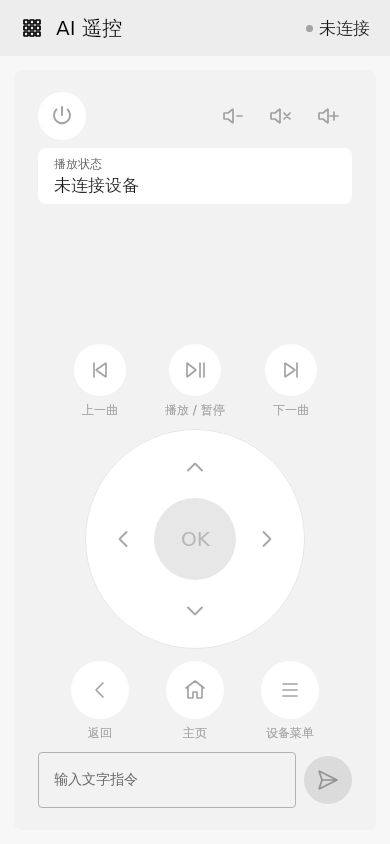

# JVM 桌面测试工具

桌面端使用 Compose，默认窗口 390×844dp，沿用手机的遥控器比例、统一主题、三列功能网格与返回路径。首页仍是遥控器，右上角进入设备页；Escape 与顶部返回效果一致。

{ width="320" }

## 启动

在项目根目录、具有图形显示环境的宿主机执行：

```sh
./gradlew --no-daemon :desktopApp:run
```

沿用项目 JDK 17 和 Gradle 配置。已有目标服务的日常遥控不需要重新构建 APK；首次构建/部署目标二进制另需 Rust、Android NDK 和项目构建环境。桌面依赖宿主机 `adb`，可用 `AIRC_ADB` 指定可执行文件。

## 连接目标

在设备页点击“刷新 ADB 设备”，选择宿主机已授权设备的“连接服务”。工具建立自己拥有的 `adb forward tcp:0 tcp:9876`，通过本机随机端口访问目标；断开或退出只删除该转发，不关闭共享 ADB server，不移除其他转发。

目标尚无服务时，点击“构建 / 部署”。此操作调用项目 `android-build-run.sh`，根据目标 ABI 构建并部署 Rust 二进制，保留目标身份和已有模型配置。部署需要从项目根目录启动；权限页的优先 root 选择作用于下次部署。取消部署停止本次宿主命令树，目标部署事务沿用既有失败回滚逻辑。

TCP ADB 可填写 `IP:ADB端口` 并点击“连接 ADB”。配对和授权可先使用宿主机原生 adb 完成；桌面端不复制手机的摄像头/二维码入口。

已有局域网服务也可直接填写地址和服务端口连接；这个通道不提供 ADB 管理权限。服务管理的构建/部署、状态、重启和停止要求通过 ADB 设备连接。

## 模型与工具

应用、触控、数字键盘、模型编辑与手机共用 Compose 组件。方向/媒体按键和应用工具无需配置模型；文字任务通过目标二进制执行。文字草稿切页后保留，只有提交被接受后才清空。

模型配置、缓存与切换逻辑复用 `client/`，详见[模型配置](models.md)。桌面与手机分别保存本地配置，只有点击“更新到目标设备”才发送。桌面使用本机 AES 密钥和加密配置文件，默认目录 `~/.local/share/airc-desktop`，可用 `AIRC_DESKTOP_STATE_DIR` 覆盖；Linux 下目录为 `0700`、密钥和配置为 `0600`。桌面私有文件存储与 Android Keystore 的安全边界不同；其他操作系统需单独验证。

## JVM 测试

常规联调优先运行：

```sh
./gradlew --no-daemon :shared:jvmTest :client:test :desktopApp:jvmTest
```

`client:test` 包含主机原生 runtime 生命周期 fixture，需要 Rust；桌面 UI 测试需要显示环境。无显示环境可使用安装了 Xvfb/xauth 的 `xvfb-run`：

```sh
SKIKO_RENDER_API=SOFTWARE xvfb-run -a ./gradlew --no-daemon :desktopApp:jvmTest
```

若缺少 xauth，可手动运行 `Xvfb -displayfd 1 -screen 0 1280x1024x24 -nolisten tcp`，用其输出的编号设置 `DISPLAY=:编号`；测试后只停止自行创建的 Xvfb 进程。

真实目标测试显式 opt-in，只读取设备信息和截图并移除本次转发：

```sh
./gradlew --no-daemon :desktopApp:jvmTest -PaircTargetSerial=IP:ADB端口
```

提供商测试同样需要显式设置 `AIRC_TEST_MODEL_URL`、`AIRC_TEST_MODEL_KEY`、`AIRC_TEST_MODEL_NAME` 后运行 `:client:test --tests ernest.airc.LiveModelProviderTest`。不要把密钥写入命令历史、源文件或日志。代理需要使用宿主机现有 JVM 网络配置；测试的工具结果是受控 fixture，不会向提供商发送目标应用列表或注入目标输入。

Android 的系统返回、旋转、软键盘和 Keystore 行为仍由专门的平台回归覆盖；JVM 成功不能替代这些 Android 验收。

## 设备显示名

设备页可修改本应用中的显示名（1–64 个字符）。名称按设备身份保存，重连后保留，不修改目标系统名称。手机的“忘记”会删除该设备记录与显示名；手机和桌面分别保存自己的名称。

## 设备预览

从功能菜单进入“设备预览”，手动获取或刷新目标画面，然后用原生保存对话框保存 PNG。保存原图，预览保持比例；已有同名文件不会覆盖，应选择新名称。桌面目前没有系统分享入口。

设备页提供分阶段网络诊断，检查填写地址或当前 ADB 转发端点的 HTTP 与 WebSocket。ADB 只检查与该端点关联的已有授权设备，mDNS 使用独立发现实例验证设备实际 IPv4 地址和服务端口，TCP ADB 的本机转发端口不会被误当作发现地址；USB 会话缺少设备 IP 时明确跳过。详见[连接指南](connections.md)。

功能菜单的“文件管理”支持目录浏览、分页、属性、流式上传/下载、确认覆盖和删除，以及确认后的全盘范围；手机与桌面共享页面。详见[文件管理](files.md)。

功能菜单新增[游戏手柄输入原型](gamepad.md)，与手机共用 NES 经典/双摇杆类型选择、布局、输入映射与释放操作；使用宿主机 ADB 部署的二进制服务，不依赖目标手柄服务 APK。

应用管理新增[仅缓存清理](cache.md)独立确认入口；缺少内部缓存权限的 shell 服务会提前拒绝，不能用删除应用数据替代。

手柄在页面中手动开始，root/uinput 可用时使用虚拟设备，非 root 使用重复短时合成输入；两者布局相同。按住/松开和左右摇杆与手机共用；桌面窗口失焦或离页停止，需要手动重启。

桌面设备预览页提供获取、刷新和保存单张 PNG；按用户要求不提供连续预览或动态镜像。Android 动态预览采用 ascrcpy，见[设备预览](screenshots.md#screen-mirror)。

媒体状态轮询按目标连接代次重新启动，快速切换或重连后会读取新会话；旧查询结果不会覆盖当前状态。


应用列表显示目标应用图标：独立获取 96×96 PNG，界面显示为 40dp，最多缓存 64 项、同时读取两项；刷新列表和连接变化清除内存缓存。每次显示 30 个应用，可继续展开，搜索覆盖完整列表。快速滚动时离屏项取消图片下载；刷新前排队的图标请求不再执行。图标读取失败不影响名称、搜索或启动。Android 使用同一套列表与缓存规则。

桌面与 Android 的文件管理页均支持[base/split 多包安装](files.md#split-apk)：逐包解析并加入清单，整组校验与独立确认后使用同一个安装会话提交。

## 外观设置

在「功能 → 设置 → 外观」选择跟随系统、亮色或暗色，立即切换并保存到当前桌面用户的偏好设置；与 Android 手机分别保存。默认跟随桌面系统模式。共享表单、菜单与确认框同步适配，截图与媒体内容保留原色。工具页的技术输出通过「查看操作详情」展开，完整结果仍可在功能网格打开。

连接服务前会比对项目配套清单的版本和运行中二进制摘要；不匹配时使用所选 ADB 设备更新，局域网直连则尝试目标 ADB 5555。部署后复核通过才启用遥控；从项目目录启动并保留配套 runtime 资产。
