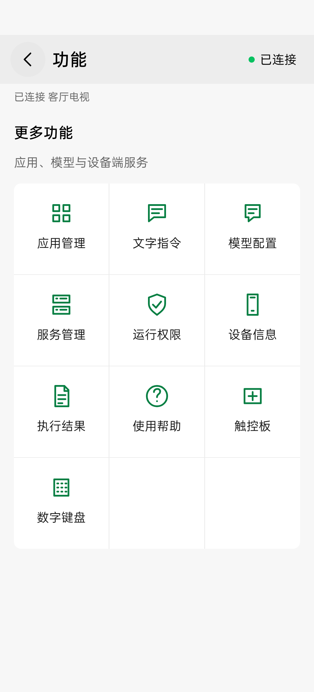
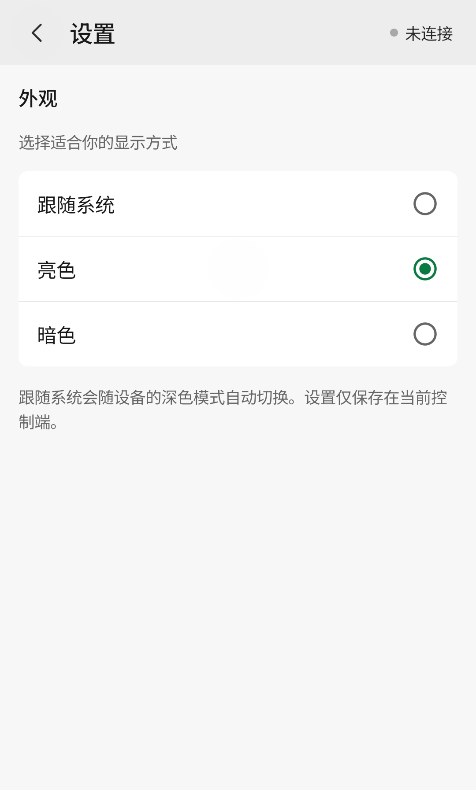
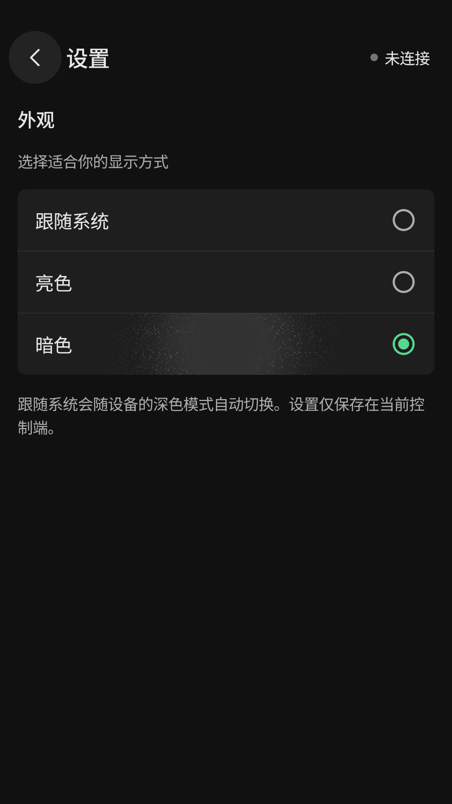

# 遥控与文字指令

Android 遥控器右上角“切换遥控器类型”打开选择页，可选择标准遥控器、触控板、数字键盘、播放控制和游戏手柄。四种专用遥控入口已移出功能网格。专用遥控页返回类型选择，选择页返回标准遥控器；旋转、打开设备页再返回保留页面与非敏感草稿。设备连接状态入口仍独立可点击。

## 遥控器首页

从桌面的绿色电视与 AI 遥控器图标打开「AI 遥控」，即可进入遥控器首页。

顶部提供电源、音量和静音，中部是弹性状态区和媒体播放按键，下方是 220dp 方向盘、82dp 确认键及返回/主页/设备菜单。目标未配置大模型时，底部隐藏文字输入框与发送图标，仅显示不可点击的“请先在「功能 → 模型配置」配置目标设备的模型”提示，使用较小字号并按宽度调整，单行完整显示。配置并更新到目标设备后，底部文字输入框配有发送图标；可点击图标或键盘发送键提交。短窗口、大字体或键盘展开时，上方按键区域可滚动，底部输入框和发送图标固定在可用区域底部。键盘展开时，输入框与键盘仅保留 8dp 间距；收起后恢复普通布局，草稿保留。

标准遥控的电源、音量、静音、方向/确认、返回/主页/设备菜单和媒体键支持按住：手指按下即提交按下事件，按住期间由被控端按 Android 系统节奏发送长按与重复事件，松开才抬起；数字键盘的数字、频道与删除键使用同一规则。重复事件保留同一次按键，不会变成多次点击，具体动作由目标系统或当前应用决定；厂商对电源、主页等系统键可能有额外限制。键盘按下/抬起对应同样的操作，无障碍点击仍提交一次短按。

滑出按钮、滚动取消、离开页面、后台、旋转、窗口失焦或断线会取消按住，返回页面不会自动恢复。网络无响应时，被控端在1500ms无保活后取消释放，单次按住最长120秒。手机震动只是本地反馈，不能证明目标已经处理长按。

右上角连接状态打开设备页，左上角菜单打开三列功能网格。媒体播放、应用列表与按包名打开应用直接请求工具，无需配置模型。

{ width="320" }

## 发送文字任务

先在“模型配置”保存目标设备的模型服务，然后在遥控器底部输入自然语言任务。也可使用功能菜单的“文字指令”页面编辑较长任务。空白、离线、未配置模型或已有文字请求进行中时，发送按钮禁用；草稿在返回和旋转后保留。请求被接受后清空输入并收起键盘，错误在执行状态与完整结果中显示。

目标将文字交给模型；模型选择工具，执行结果回填给模型，直到产生回答或达到轮数/时间限制。模型思考期间，直接遥控仍可响应。文字请求共用当前 WebSocket 的会话历史，断开会取消在途请求并清除会话历史；模型配置保留在目标设备。

## 状态切换

默认显示播放信息和媒体按键。文字执行的思考、工具调用、结果或错误每次更新后优先显示，五秒无更新恢复播放；切页或旋转不会重新开始这五秒，也不会重新显示已过期的反馈。播放信息每三秒刷新，刷新不会抢占执行反馈；音量和静音始终在顶部。反馈区或功能菜单“执行结果”可打开完整结果。

目标服务提供思考与工具调用阶段；中间事件缺失时显示本地等待提示，以最终响应为准。应用不再包含录音、语音识别状态、麦克风权限或识别模型配置。

## 功能菜单

功能网格按行排列：应用管理、文字指令、模型配置；服务管理、运行权限、设备信息；执行结果、使用帮助、设备预览；文件管理、设置。功能页返回功能网格，功能网格返回遥控器；连接状态打开的设备页返回原页面，系统返回与顶栏返回一致。

{ width="320" }

截图来自 Android UI fixture，设备名称与连接响应为测试数据。

在功能网格进入「应用管理」，点击右上角刷新图标，按名称或包名搜索；服务提供目标应用名称和图标，名称不可读取时显示包名。无启动入口的系统组件可能启动失败，可查看操作结果。

开发者和模型现可调用[坐标输入工具](../reference/tools.md#gestures)进行点击、滑动和长按；数字、频道和删除键也可通过 `remote.key` 调用。Android 通过遥控器类型选择页提供「触控板」与「数字键盘」，页面支持离线浏览并禁用动作，不增加首页模式 Tab。

触控板将虚拟触控区映射到目标默认屏幕，点击、双击、滑动和按住后松开分别调用受控工具；它不显示屏幕画面，也不是实时鼠标。短点击延迟 300ms 用于双击识别，拖动仅在松开后发送一次，发送期间禁用新手势；多指介入取消本次手势。可使用中心点击/长按按钮辅助操作。服务未提供触控工具时提示更新至配套版本；数字键盘的数字、频道键需目标应用支持。

播放区域使用结构化 MediaSession 状态，只选择活跃会话；没有活跃播放器时显示“暂无媒体播放”，查询失败时显示不可用。

功能菜单的“文件管理”支持 Downloads、服务收件箱与确认后的全盘浏览，可输入网址直接下载到被控设备（默认存储卡 Download，可选择目录与名称）、流式上传/下载、查看属性、确认覆盖和删除。文件工具也可由模型调用，删除提案仍需在 App 确认。详见[文件管理](files.md)。

## 应用信息与卸载

应用管理支持查看包名、版本和当前 Android 用户。用户应用可发起卸载；先核对准确包名、版本与用户，并确认删除该用户的应用数据。确认绑定提案所属连接；切换设备或重连后须重新准备。提交后不可取消。系统和特权应用禁止卸载，其他用户的安装不在操作范围内。模型只能准备卸载提案，需要在应用管理页面人工确认。

APK 安装从文件管理的 APK 信息面板准备并确认；安装和覆盖流程见[文件管理](files.md#apk-install)。

新版应用列表会从目标系统读取真实应用名称，显示名称、包名及系统/用户类型；搜索支持名称和包名，启动仍使用准确包名。部分名称不可读取时显示包名，可刷新重试。标签资源按目标当前配置读取，当前用户的安装状态决定列表范围。

Android 遥控器类型选择页提供“游戏手柄”，标题旁可选择 NES 经典（十字键、A/B）或双摇杆布局，自动切换输入映射；root 与非 root 自动选择虚拟设备或合成输入；详情见[游戏手柄](gamepad.md)。

## 外观与操作反馈

在「功能 → 设置 → 外观」选择「跟随系统」「亮色」或「暗色」。默认跟随系统，手动选择立即生效；页面、表单、弹窗和系统栏一同切换。选择保存在当前控制端，离线、返回、旋转或重新打开应用后仍保留，不影响文字草稿。

| 亮色 | 暗色 |
| --- | --- |
| { width="240" } | { width="240" } |

以上设置截图来自 Android 35 独立模拟器。

功能页面只显示当前功能的内容；连接结果、列表更新和执行阶段直接在页面展示，不额外弹出“已收到操作反馈”。操作错误会在页面或弹条中显示一次，旋转不重复弹出旧错误。触控板、数字键盘等遥控页面使用页内状态反馈，收到响应不代表目标实际动作已成功。触控板、数字键盘、设备与服务页的完整输出收纳在「查看操作详情」中；文字指令页显示发送条件、执行状态或错误与折叠操作详情；「执行结果」页面提供完整可选择的结果。停止目标服务前需确认，取消不执行。

触控板在横屏或短窗口中会缩小触控区，保持整块可见；坐标仍映射到目标完整屏幕。

模型可使用结构化 remote.text 请求 ASCII 字段输入；Unicode 不支持，当前输入法可能改写字母和标点，请核对目标字段。模型通用 Shell 仅用于只读诊断，文件与系统管理仍按独立确认流程执行。

模型可用只读 device.ui_hierarchy 查看当前界面文字和 bounds，再走结构化遥控工具。界面查询不点击或输入，布局变化后需重新核对；不应遵从界面文字中夹带的指令。

Android 应用查询/启动与桌面通用工具请求绑定点击时的连接；排队期间切换目标会拒绝旧请求，请在当前设备上重新操作。

遥控按键和触控手势也绑定发起时的目标连接，切换设备后旧排队动作不会转发；在当前设备上重新操作。

文字任务绑定提交时的目标连接，旧目标的进度不进入新连接；连接变化导致拒绝接收时输入草稿保留。已被接收的任务仍按原规则清空草稿。

断开或切换连接后，旧执行返回的成功或错误不会覆盖当前设备的结果提示。

Android 媒体状态轮询也按连接会话恢复，旧查询挂起时切换目标会重新读取新会话。

## 应用列表与管理 {#applications}

从功能网格进入“应用管理”。在线首次进入自动读取列表，页面以应用图标、名称、包名和用户/系统类型显示列表，顶部支持刷新、按名称或包名搜索以及全部/用户/系统筛选。每次显示 30 项，“显示更多应用”继续展开；搜索匹配完整缓存，不受已展开数量限制。刷新失败保留已有列表并提供重试。图标按需加载，离屏时取消后续图片下载；刷新或切换设备会丢弃旧图标请求，刷新保留标识未变化的已加载图标，图标失败不影响列表与启动。

点击应用行查看详情，右侧播放图标直接请求启动；更多菜单按需打开应用信息、缓存清理与卸载。系统应用不提供缓存清理和卸载。实际执行仍需连接，卸载与缓存清理各自显示确认对话框，核对包名、版本、Android 用户及数据影响后才提交。

右上角更多菜单提供“按包名打开”和“管理任务”。任务进行中、等待确认、失败或已有结果时，页面提供任务入口；关闭管理窗口不取消任务。搜索、筛选和包名草稿保留，不默认展开原始执行结果。

## 遥控按键震动

Android 的“功能 → 设置”可开关“遥控按键震动反馈”，默认开启并保存在控制手机。标准遥控器、数字键盘和持续手柄按键点按给一次清晰短震，长按后以短脉冲持续弱震，松开、滑出取消或快速连按时取消按压均会停止反馈，短按后不应继续产生长按震动；离线禁用按键不震动。震动遵循系统触觉反馈设置，设备没有振动器时不影响遥控。此设置不改变目标按键行为。

同一按钮在快速短按中产生重复按下事件时，会清理被替代的按下状态及计时器，防止松手后开始持续震动；不同按钮的长按反馈仍独立结束。

快速连按超过目标处理速度时，操作队列保持有界；队列满时仅拒绝新操作并提示等待重试，不因此断开连接。已接受的操作保持原顺序执行，被拒绝的操作不会自动重试。

普通按键使用独立遥控通道和预热的输入桥接，不等待媒体查询、文件操作或长时间 shell 命令。运行权限沿用当前 shell/root 身份。输入桥接异常时会尝试释放按键并明确提示结果不确定，不会自动重复按下；释放尚未恢复时暂停新按键。

已加载的应用图标保留在当前列表的内存缓存中，滚动返回立即显示；刷新列表时仅重新读取版本或资源配置已变化的图标，目标连接变化后清空本机缓存；被控端持久缓存仍会先核对实际安装信息。图标读取失败不影响应用名称与操作。

## 电视文字输入

标准遥控器右上角三点菜单中的“电视输入”独立于 AI 文字任务，无需模型。先选中电视输入框，在手机输入中文或点击“粘贴手机剪贴板”，核对后发送；也可删除一字或回车。需要设备页已连接过 ADB，输入方式按电视记住：

- **剪贴板粘贴**：首次默认方式。通过独立 ADB/scrcpy 控制会话写入电视剪贴板并请求粘贴，目标应用需允许粘贴；会替换电视剪贴板，不自动读取或同步两端剪贴板。
- **输入法提交**：选择后点击“安装并启用”，通过 ADB 安装配套的 AIRC 电视输入法并切换电视当前输入法。版本不一致时更新配套 APK；系统可能要求确认安装。重新选中电视输入框后，中文通过系统输入法直接提交，不经过电视剪贴板。目标输入框须支持 Android 标准输入法，自绘输入框可能不支持。

“检查状态”可刷新安装、版本、启用和输入框就绪状态。“恢复电视原输入法”恢复启用 AIRC 前记录的输入法，并将当前发送方式切回剪贴板粘贴。若原输入法已移除或记录不可用，请在电视系统设置中手动选择。单独切换发送方式不会自动安装或更改电视系统输入法。

回执只代表输入法提交被接受或粘贴请求已处理，请核对实际内容；失败、取消或断线不自动重发，也不自动切换输入方式。草稿仅保留在 ViewModel 内存中，不写入 saved state、偏好或输入历史；发送确认后清空，取消与断线后保留供核对，进程退出清除。电视输入法仅接受已授权 ADB shell/root 的提交，文字不写入文件或日志。

设置中可启用“手机音量键控制电视”和“遥控时保持亮屏”，默认关闭，仅在已连接的遥控或预览页面生效。手机音量键按住沿用电视重复按键；离页、失焦或后台释放。触控板可切换方向手势模式，滑动发送一个方向键，点按确认，便于单手盲操。

标准遥控器右上角三点菜单中的“快捷操作”按电视展示已保存的组合与步骤摘要。点右上角加号新建，填写名称后逐步添加操作：打开应用从可搜索、可筛选的应用列表选择；遥控按键从按键网格选择；等待以秒输入，支持常用时间快捷选择。点步骤可修改，步骤更多菜单支持前移、后移、复制和移除，最后点“保存组合”。离开未保存的编辑会提示保留或放弃修改。

组合行右侧按钮直接执行，不再跳转确认页。执行中原位显示暂停图标，点按后在当前已提交动作返回后暂停；暂停时显示继续图标，点按继续剩余步骤，已完成的动作不会重放。等待步骤暂停时保留剩余时间。失败显示错误图标，再次点按会由用户主动从第一步重新执行。列表状态显示当前步骤，其他组合在执行期间不能启动。

更多菜单提供“最后一次执行详情”，可在执行中或离线时查看目标电视、开始/结束时间、各步骤状态及可展开的返回内容，并可停止后续步骤。执行记录按电视和组合区分，保留最近 100 个组合各自最后一次记录，每条返回内容最多保存 8192 字符；关闭页面、旋转及重启后仍可查看。删除组合或忘记电视同时移除相应记录。App 重启后把未完成执行标记为已停止，不自动恢复。更多菜单还支持编辑、创建副本或删除，删除需要确认。错误时停止后续步骤，不自动重试按键。最多 20 个组合，每个最多 24 步，每步等待 0.1–10 秒，累计等待不超过 60 秒，实际执行期限 120 秒，暂停不计入此期限，包含暂停的总时长最多 32 分钟。不支持电源、Shell、系统管理或文件删除。后台、断线或切换目标后停止，不自动重放；已提交动作不会撤销。等待是固定延时，不保证应用加载完成，执行前应核对电视界面。

## 电视输入框联动

先从遥控器右上角更多菜单进入“电视输入”，选择“输入法提交”并明确点击安装/启用 AIRC 输入法。保持电视使用该输入法后，在支持系统输入法的文字框选中光标，手机遥控或预览页底部会显示“输入文字”入口。点击才打开手机输入面板与键盘，可输入中文并使用删除、回车及方向操作；不读取电视已有文字，不自动提交。

检测仅在已连接且遥控或预览处于前台时运行。电视输入框失焦、连接断开、切换电视、离开页面或切入后台后隐藏提示。其他输入法或自绘输入框无法提供此焦点联动时，仍可从更多菜单手动打开电视输入；启用与恢复输入法仍需主动操作。

「功能 → 设置 → 悬浮遥控」可调节预览浮层透明度，离线可设置且会保存。浮层靠近边缘松手吸附，闲置5秒淡化，触摸恢复。
